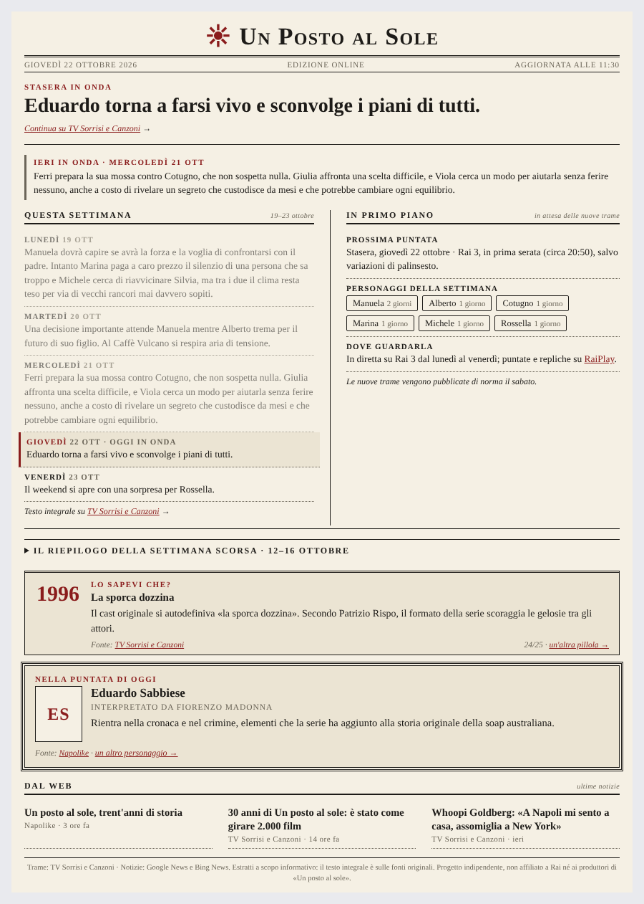
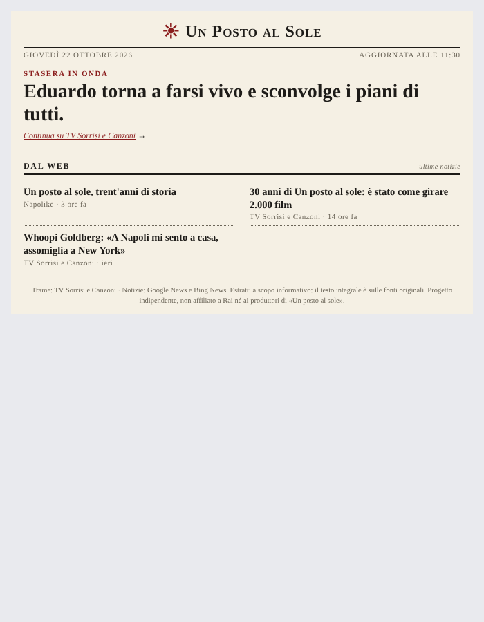

<p align="center"></p>

# Un Posto al Sole per Home Assistant

[](https://hacs.xyz)
[](https://github.com/stefanodr/ha-upas/releases)
[](https://github.com/stefanodr/ha-upas/actions/workflows/validate.yaml)
[](LICENSE)

🇬🇧 [English version](README.md)

[](https://my.home-assistant.io/redirect/hacs_repository/?owner=stefanodr&repository=ha-upas&category=integration)

Anticipazioni **giorno per giorno della settimana corrente e della successiva**, più le **ultime notizie dal web**, presentate in una card in **stile quotidiano**.



> Progetto indipendente della community, non affiliato a Rai né ai produttori di «Un posto al sole».

## Novità della 1.1
- **Seconda fonte per le trame (ripiego):** se TV Sorrisi e Canzoni non ha l'articolo di una settimana, l'integrazione prova DiLei (articoli scoperti tramite il feed delle notizie). La settimana mostra la fonte reale.
- **Il riepilogo della settimana scorsa funziona dal primo giorno:** alla prima installazione la settimana precedente viene recuperata una volta.
- **Nuove entità:** sensori *Prossima pausa* e *Puntate di fila*, pulsante **Aggiorna ora**. L'avviso in Riparazioni ha ora l'azione **Riprova ora**.
- **Card:** i personaggi della settimana sono **cliccabili** (apre la scheda) e le etichette delle settimane vengono tradotte con la card in inglese.
- **Blueprint** per il promemoria prima della puntata, con opzione **senza spoiler**.
- **Controllo settimanale delle fonti** (GitHub Actions) per accorgersi presto di un cambio di struttura; 7 nuove pillole.

## Novità della 1.0
- **Ieri in onda** e **riepilogo della settimana scorsa** (a scomparsa), grazie a un archivio che resta anche dopo i riavvii.
- **Giorni senza puntata** riconosciuti (es. pause o eventi sportivi) e mostrati come tali.
- **Calendario** delle puntate, **entità evento** (nuova trama pubblicata, puntata in partenza) e servizio **`upas.get_summary`** per Assist e script.
- **Card**: editor visivo, aspetto **compatto**, modalità **senza spoiler**, interfaccia **italiano/inglese**.
- **Notizie**: scegli le fonti ed escludi parole indesiderate. **Opzioni**: titolo della testata e orario di messa in onda.
- **Diagnostica** scaricabile e avviso in **Riparazioni** se le fonti non rispondono da molto.

## Cosa fa
- **Lo sapevi che?**: una pillola al giorno con aneddoti sulla storia della serie, sempre con la fonte e un pulsante per sfogliare le altre.
- Legge le trame settimanali pubblicate da TV Sorrisi e Canzoni (di norma il sabato per la settimana dopo) e le divide per giorno.
- Raccoglie titoli, testata e data delle notizie da due feed RSS (Google News e Bing News), uniti e senza doppioni. Se una fonte non risponde, usa l'altra.
- Mostra estratti brevi con link alla fonte: il testo integrale resta sul sito originale.
- Nel weekend la "settimana corrente" diventa quella che inizia lunedì, così sai già cosa arriva.
- Se la settimana successiva non è ancora stata pubblicata, la card mostra la sezione **In primo piano**: prossima puntata, personaggi della settimana e dove guardarla. Appena le trame escono, torna la colonna con i giorni.

## Installazione con HACS
1. In HACS cerca **Un Posto al Sole**, scarica e **riavvia Home Assistant**.
2. **Impostazioni → Dispositivi e servizi → Aggiungi integrazione → Un Posto al Sole**.

**Alternativa (repository personalizzato)**, se non la trovi nella ricerca: HACS → ⋮ → **Repository personalizzati** → incolla `https://github.com/stefanodr/ha-upas`, categoria **Integrazione**, poi segui i punti sopra.

### Installazione manuale
Copia `custom_components/upas` in `<config>/custom_components/upas` e riavvia.

## La card
L'integrazione include la card `custom:upas-card` e **la registra da sola** tra le risorse della dashboard (modalità storage). Dopo l'installazione riavvia Home Assistant e ricarica il browser con Ctrl+F5.

Se usi dashboard in **modalità YAML**, o vedi l'errore **"Custom element doesn't exist: upas-card"**, aggiungi la risorsa a mano (una volta sola):

1. Attiva la **Modalità avanzata** nel tuo profilo utente.
2. Vai in *Impostazioni → Dashboard → ⋮ → Risorse → Aggiungi risorsa*.
3. URL `/upas_static/upas-card.js`, tipo **Modulo JavaScript**, poi *Crea*.
4. Ricarica il browser con **Ctrl+F5** (nell'app companion: *Impostazioni → Companion app → Debug → Svuota cache frontend*).

Poi, nella dashboard: **Aggiungi scheda → Manuale**:

```yaml
type: custom:upas-card
title: La Gazzetta di Posillipo   # facoltativo
max_news: 6                       # facoltativo
show_news: true                   # facoltativo
theme: light                      # facoltativo: light (default), dark, auto
show_trivia: true                 # facoltativo: "Lo sapevi che?" e "Personaggio del giorno"
photos_path: /local/upas          # facoltativo: le tue foto dei personaggi (vedi sotto)
show_highlights: true             # facoltativo: "In primo piano" quando la settimana prossima non e' ancora pubblicata
layout: full                      # facoltativo: full (default) o compact
spoiler_free: false               # facoltativo: sfoca le trame da oggi in poi finche' non le tocchi
show_yesterday: true              # facoltativo: "Ieri in onda"
show_recap: true                  # facoltativo: riepilogo della settimana scorsa
language: auto                    # facoltativo: auto (lingua di Home Assistant), it, en
```

Tutte le opzioni si possono cambiare anche dall'**editor visivo** della card. Se `title` manca, la card usa il titolo della testata scelto nelle opzioni dell'integrazione.

**Aspetto compatto** (`layout: compact`): titolo, puntata del giorno e poche notizie.



**Senza spoiler** (`spoiler_free: true`): le trame da oggi in poi sono sfocate finché non le tocchi; i personaggi citati nella trama non vengono anticipati. La modalità vale per la card; i sensori continuano a esporre il testo completo.

**Tema:** `light` (carta chiara, come nell'anteprima) è il default; `dark` forza lo stile scuro; `auto` segue il tema di Home Assistant.

Per verificare che il file sia servito, apri `http://IP-DI-HA:8123/upas_static/upas-card.js`: devi vedere il codice JavaScript.

## Lo sapevi che? e Personaggio del giorno
Sotto le trame la card mostra due riquadri:
- **Lo sapevi che?** Una pillola al giorno su storia e curiosità della serie (record, anniversari, momenti che hanno fatto notizia). Ogni pillola riporta la fonte con il link; il pulsante *un'altra pillola* le scorre. Nei giorni di ricorrenza (es. il 21 ottobre, anniversario della prima puntata) compare quella dedicata.
- **Personaggio del giorno.** Se nella trama di oggi è citato un personaggio, viene scelto lui (*Nella puntata di oggi*); altrimenti si ruota ogni giorno. Mostra interprete, ruolo, una breve didascalia e la fonte.

I testi stanno in `custom_components/upas/data/trivia.json` e `characters.json`: sono brevi, parafrasati e con la fonte. Puoi proporne altri con una pull request (solo fatti verificabili, con link alla fonte). Si possono nascondere con `show_trivia: false`.

### Foto del personaggio (facoltativo)
Per questioni di diritti l'integrazione **non include foto** di attori o di scena: di default il personaggio ha un monogramma. Se vuoi le foto, aggiungi le **tue** immagini (di cui hai i diritti):
1. Crea la cartella `/config/www/upas/` e mettici file `.jpg` con questi nomi: `alberto.jpg`, `eduardo.jpg`, `ferri.jpg`, `guido.jpg`, `michele.jpg`, `niko.jpg`, `raffaele.jpg`, `renato.jpg`, `samuel.jpg`, `serena.jpg`, `silvia.jpg`.
2. Nella card aggiungi `photos_path: /local/upas`.

Se un file manca, resta il monogramma.

## Entità
| Entità | Stato | Attributi principali |
|---|---|---|
| Edizione | data/ora ultimo aggiornamento | `today`, `yesterday`, `this_week`, `next_week`, `previous_week`, `news`, `masthead_title` |
| Puntata di oggi | estratto della trama (o «Non in onda: …») | `date`, `weekday`, `excerpt`, `no_episode`, `pause_note`, `url` |
| Ieri in onda | come sopra, per ieri | come sopra |
| Questa settimana | es. `19–23 ottobre` | `days[]`, `url`, `source`, `published` |
| Prossima settimana | es. `26–30 ottobre` oppure `In arrivo` | come sopra |
| Settimana scorsa | dall'archivio | come sopra |
| Personaggio del giorno | nome e interprete | `role`, `caption`, `source`, `in_todays_plot` |
| Notizie | numero di notizie | `articles[]` (titolo, testata, url, data) |
| Lo sapevi che | testo della pillola del giorno | `year`, `title`, `text`, `source`, `url` |
| Prossima pausa | data del prossimo giorno senza puntata, o «Nessuna pausa nota» | `days_until`, `note`, `url` |
| Puntate di fila | puntate consecutive note da oggi | |
| Aggiorna ora (pulsante) | forza l'aggiornamento | |
| Puntate (calendario) | prossima puntata | eventi alle ore di messa in onda |
| Messa in onda (evento) | ultimo evento | `week_published`, `episode_starting` |

Gli ID entità dipendono dalla lingua di Home Assistant (es. `sensor.un_posto_al_sole_puntata_di_oggi` in italiano): controllali in *Impostazioni → Entità*. Un esempio di notifica serale è in [`examples/automation_notifica.yaml`](examples/automation_notifica.yaml).

## Automazioni, calendario e Assist
- **Evento**: l'entità *Messa in onda* scatta con `episode_starting` all'orario di messa in onda (solo nei giorni con puntata) e con `week_published` quando esce la trama della settimana dopo. Esempio: [`examples/automation_notifica.yaml`](examples/automation_notifica.yaml).
- **Calendario**: le puntate note (anche passate, dall'archivio) compaiono nel calendario *Puntate*.
- **Servizio `upas.get_summary`** (restituisce dati, utile per Assist/LLM e script): `scope` può essere `today`, `yesterday`, `this_week`, `next_week`, `previous_week`, `news`.

```yaml
action: upas.get_summary
data:
  scope: today
response_variable: puntata
```

### Blueprint: promemoria prima della puntata
Promemoria poco prima dell'inizio, con o senza anticipazione (opzione senza spoiler):

[](https://my.home-assistant.io/redirect/blueprint_import/?blueprint_url=https%3A%2F%2Fgithub.com%2Fstefanodr%2Fha-upas%2Fblob%2Fmain%2Fblueprints%2Fautomation%2Fupas%2Fnotify_tonight.yaml)

## Esempio di dashboard
Per una pagina a tutto schermo crea una vista di tipo **Pannello (1 scheda)** e inserisci la card; un esempio è in [`examples/dashboard.yaml`](examples/dashboard.yaml).

## Opzioni
Intervallo di aggiornamento (60–1440 min, default 360), notizie on/off, numero massimo di notizie, **fonti delle notizie** (Google/Bing), **parole da escludere** (separate da virgola, valgono su titolo e testata), **titolo della testata** e **orario di messa in onda** (default 20:50, usato da calendario ed evento). Il salvataggio ricarica l'integrazione.

**Diagnostica e riparazioni:** in *Dispositivi e servizi → Un Posto al Sole → ⋮ → Scarica diagnostica* trovi lo stato delle fonti. Se nessuna fonte risponde per diversi aggiornamenti di fila compare un avviso in *Riparazioni* (si chiude da solo al ritorno dei dati). Nel frattempo vengono mostrati gli ultimi dati validi.

## Fonti e limiti
- Trame: <https://www.sorrisi.com/tag/un-posto-al-sole/> (articoli «le trame dal X al Y»).
- Notizie: Google News e Bing News (RSS).
- Il parsing dipende dalla struttura delle pagine: se una fonte cambia, la card mostra "in arrivo" o nessuna notizia e nei log (livello debug) trovi il dettaglio. I parser stanno in `parsers.py` e sono coperti da test.
- Gli estratti sono limitati a ~280 caratteri per giorno. Rispetta i termini d'uso delle fonti e non abbassare l'intervallo di aggiornamento senza motivo.

## Problemi frequenti
| Sintomo | Cosa fare |
|---|---|
| "Custom element doesn't exist: upas-card" | Aggiungi la risorsa a mano come descritto in [La card](#la-card), poi **Ctrl+F5**. |
| "Prossima settimana: In arrivo" | Normale: le trame vengono pubblicate di norma il sabato precedente. |
| Nessuna notizia | Controlla che l'opzione notizie sia attiva e guarda i log con livello debug (`custom_components.upas`). |
| Trame vuote dopo un cambio di sito | Apri una [issue](https://github.com/stefanodr/ha-upas/issues) indicando l'articolo che non viene letto. |

Per i log dettagliati:
```yaml
logger:
  logs:
    custom_components.upas: debug
```

## Controllo delle fonti
Una GitHub Action gira ogni lunedì (`scripts/check_sources.py`) e fallisce se i parser non riescono più a leggere le fonti reali, così i cambi di struttura si notano subito. In locale: `python scripts/check_sources.py`.

## Sviluppo
```bash
pip install -r requirements_test.txt
pytest
```

## Licenza
MIT. Icona e logo sono originali (sole sul golfo) e non riproducono il marchio della serie.
