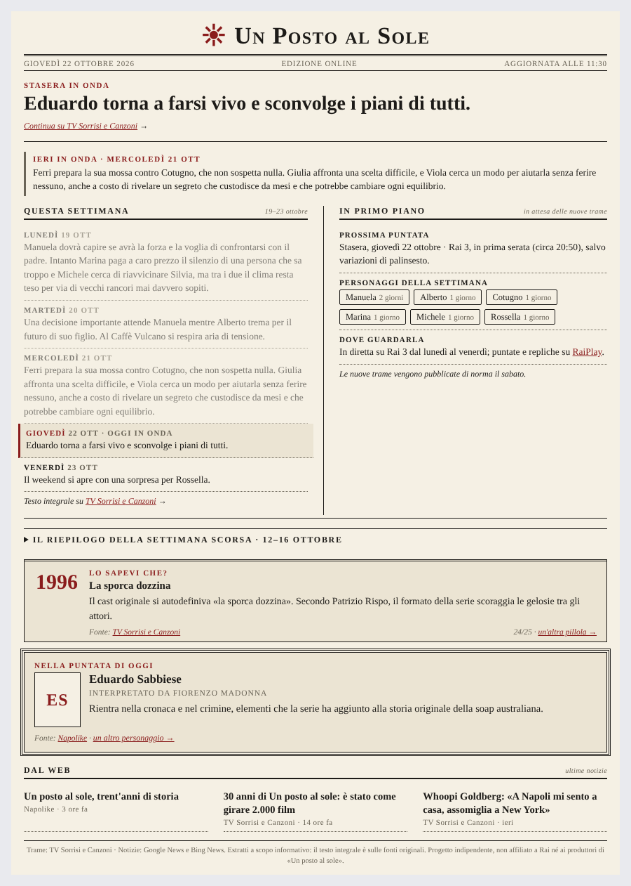
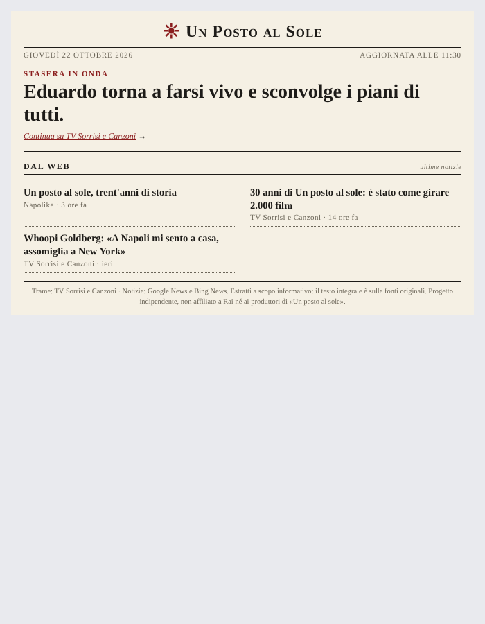

<p align="center"></p>

# Un Posto al Sole for Home Assistant

🇮🇹 [Versione italiana](README.it.md)

[](https://hacs.xyz)
[](https://github.com/stefanodr/ha-upas/releases)
[](https://github.com/stefanodr/ha-upas/actions/workflows/validate.yaml)
[](LICENSE)

[](https://my.home-assistant.io/redirect/hacs_repository/?owner=stefanodr&repository=ha-upas&category=integration)

Day-by-day plot previews for the **current and next week** of the Italian soap *Un posto al sole*, plus the **latest news from the web**, shown in a **newspaper-style** Lovelace card.



> Independent community project, not affiliated with Rai or the producers of "Un posto al sole". The plots and trivia are in Italian.

## What's new in 1.1
- **Second plot source (fallback):** if TV Sorrisi e Canzoni has no article for a week, the integration tries DiLei (articles discovered through the news feed). The week shows its real source.
- **Last-week recap works from day one:** on first install the previous week is fetched once.
- **New entities:** *Next break* and *Episodes in a row* sensors, and a **Refresh now** button. The Repairs notice now has a **Retry now** action.
- **Card:** characters of the week are **clickable** (opens the character profile) and week labels are translated when the card is in English.
- **Blueprint** for a reminder before the episode, with a **spoiler-free** option.
- **Weekly source check** (GitHub Actions) to catch a source layout change early; 7 new trivia pills.

## What's new in 1.0
- **Yesterday on air** and a collapsible **last-week recap**, backed by an archive that survives restarts.
- **Days without an episode** (breaks, sports events) are detected and shown as such.
- **Calendar** of episodes, **event entity** (new plot published, episode starting) and the **`upas.get_summary`** service for Assist and scripts.
- **Card**: visual editor, **compact** layout, **spoiler-free** mode, **Italian/English** UI.
- **News**: choose the sources and exclude unwanted words. **Options**: masthead title and air time.
- Downloadable **diagnostics** and a **Repairs** notice when the sources have been unreachable for a long time.

## What it does
- Reads the weekly plots published by TV Sorrisi e Canzoni (usually on Saturday for the following week) and splits them by day.
- Collects headlines, source and date of the news from two RSS feeds (Google News and Bing News), merged without duplicates. If one feed is down, the other is used.
- Shows short excerpts with a link to the source: the full text stays on the original site.
- On weekends the "current week" becomes the one starting on Monday, so you already see what's coming.
- While next week's plots are not out yet, the card shows **In the spotlight**: next episode, characters of the week and where to watch.
- **Did you know?** A daily trivia pill about the history of the series, always with its source.
- **Character of the day** with actor, role, a short caption and source.

## Installation with HACS
1. In HACS search for **Un Posto al Sole**, download it and **restart Home Assistant**.
2. **Settings → Devices & services → Add integration → Un Posto al Sole**.

**Alternative (custom repository)**, if you can't find it in the search: HACS → ⋮ → **Custom repositories** → paste `https://github.com/stefanodr/ha-upas`, category **Integration**, then follow the steps above.

### Manual installation
Copy `custom_components/upas` to `<config>/custom_components/upas` and restart.

## The card
The integration ships the `custom:upas-card` card and **registers it by itself** in the dashboard resources (storage mode). After installing, restart Home Assistant and hard-reload the browser (Ctrl+F5).

If you use **YAML-mode** dashboards, or you see **"Custom element doesn't exist: upas-card"**, add the resource by hand (once):

1. Enable **Advanced mode** in your user profile.
2. Go to *Settings → Dashboards → ⋮ → Resources → Add resource*.
3. URL `/upas_static/upas-card.js`, type **JavaScript module**, then *Create*.
4. Hard-reload the browser (**Ctrl+F5**; in the companion app: *Settings → Companion app → Debug → Reset frontend cache*).

Then add the card from the UI (**Add card → Un Posto al Sole**, with a **visual editor**) or manually:

```yaml
type: custom:upas-card
title: La Gazzetta di Posillipo   # optional (default: title from the integration options)
max_news: 6                       # optional
show_news: true                   # optional
theme: light                      # optional: light (default), dark, auto (follows Home Assistant)
layout: full                      # optional: full (default) or compact
spoiler_free: false               # optional: blurs plots from today on until you tap them
show_yesterday: true              # optional: "Yesterday on air"
show_recap: true                  # optional: last-week recap (collapsible)
show_trivia: true                 # optional: "Did you know?" and "Character of the day"
show_highlights: true             # optional: "In the spotlight" while next week is not published
language: auto                    # optional: auto (Home Assistant language), it, en
photos_path: /local/upas          # optional: your own character photos (see below)
```

**Compact layout** (`layout: compact`): title, today's episode and a few news items.



**Spoiler-free** (`spoiler_free: true`): plots from today on are blurred until tapped, and characters cited in the plot are not revealed. It applies to the card only; the sensors still expose the full text.

To check the file is served, open `http://HA-IP:8123/upas_static/upas-card.js`: you should see JavaScript code.

## Did you know? and Character of the day
- **Did you know?** One pill a day about the series' history (records, anniversaries, moments that made the news). Each pill has its source link; *another one* cycles through them. On anniversaries (e.g. 21 October, the first episode) the dedicated pill appears.
- **Character of the day.** If a character is cited in today's plot, that one is chosen; otherwise it rotates daily. It shows actor, role, a short caption and the source.

The texts live in `custom_components/upas/data/trivia.json` and `characters.json`: short, paraphrased, with source. Pull requests with more are welcome (verifiable facts only, with a source link).

### Character photos (optional)
For copyright reasons the integration **does not ship photos** of actors or scenes; characters get a monogram. If you want photos, add **your own** images you have the rights to:
1. Create `/config/www/upas/` and put `.jpg` files in it named after the character id (e.g. `alberto.jpg`, `eduardo.jpg`, `silvia.jpg`; ids are in `characters.json`).
2. Add `photos_path: /local/upas` to the card.

If a file is missing, the monogram stays.

## Entities
Entity IDs depend on Home Assistant's language (in English e.g. `sensor.un_posto_al_sole_today_s_episode`): check *Settings → Entities*.

| Entity | State | Main attributes |
|---|---|---|
| Edition | last update time | `today`, `yesterday`, `this_week`, `next_week`, `previous_week`, `news`, `masthead_title` |
| Today's episode | plot excerpt (or "Non in onda: …") | `date`, `weekday`, `excerpt`, `no_episode`, `pause_note`, `url` |
| Yesterday's episode | same, for yesterday | same |
| This week | e.g. `19–23 ottobre` | `days[]`, `url`, `source`, `published` |
| Next week | e.g. `26–30 ottobre` or `In arrivo` | same |
| Last week | from the archive | same |
| Character of the day | name and actor | `role`, `caption`, `source`, `in_todays_plot` |
| News | number of items | `articles[]` (title, source, url, date) |
| Did you know | text of today's pill | `year`, `title`, `text`, `source`, `url` |
| Next break | date of the next episode-less day, or "Nessuna pausa nota" | `days_until`, `note`, `url` |
| Episodes in a row | consecutive known episodes from today | |
| Refresh now (button) | forces an update | |
| Episodes (calendar) | next episode | events at air time |
| Broadcast (event) | last event | `week_published`, `episode_starting` |

## Automations, calendar and Assist
- **Event**: the *Broadcast* entity fires `episode_starting` at air time (only on days with an episode) and `week_published` when next week's plot comes out. Example: [`examples/automation_notifica.yaml`](examples/automation_notifica.yaml).
- **Calendar**: known episodes (also past ones, from the archive) appear in the *Episodes* calendar.
- **`upas.get_summary` service** (returns data, handy for Assist/LLMs and scripts): `scope` is one of `today`, `yesterday`, `this_week`, `next_week`, `previous_week`, `news`.

```yaml
action: upas.get_summary
data:
  scope: today
response_variable: episode
```

### Blueprint: reminder before the episode
Reminder shortly before the episode starts, with or without the plot (spoiler-free option):

[](https://my.home-assistant.io/redirect/blueprint_import/?blueprint_url=https%3A%2F%2Fgithub.com%2Fstefanodr%2Fha-upas%2Fblob%2Fmain%2Fblueprints%2Fautomation%2Fupas%2Fnotify_tonight.yaml)

## Dashboard example
For a full-screen page create a **Panel (1 card)** view and add the card; see [`examples/dashboard.yaml`](examples/dashboard.yaml).

## Options
Update interval (60–1440 min, default 360), news on/off, max number of news, **news sources** (Google/Bing), **words to exclude** (comma separated, matched on title and source), **masthead title** and **air time** (default 20:50, used by the calendar and the event). Saving reloads the integration.

**Diagnostics and repairs:** in *Devices & services → Un Posto al Sole → ⋮ → Download diagnostics* you find the state of the sources. If no source answers for several updates in a row a notice appears in *Repairs* (it closes by itself when data is back). Meanwhile the last valid data is shown.

## Sources and limits
- Plots: <https://www.sorrisi.com/tag/un-posto-al-sole/> ("le trame dal X al Y" articles). Fallback: DiLei weekly articles, discovered through Bing News (limited to recent weeks).
- News: Google News and Bing News (RSS).
- Parsing depends on the pages' structure: if a source changes, the card shows "in arrivo" or no news, and the debug log has details. Parsers are in `parsers.py` and covered by tests.
- Excerpts are limited to ~280 characters per day. Respect the sources' terms of use and don't lower the update interval without reason.

## Troubleshooting
| Symptom | What to do |
|---|---|
| "Custom element doesn't exist: upas-card" | Add the resource by hand as described in [The card](#the-card), then **Ctrl+F5**. |
| "Next week: In arrivo" | Normal: plots are usually published the Saturday before. |
| No news | Check the news option is on and the sources/blocklist in the options; enable debug logging. |
| Empty plots after a site change | Open an [issue](https://github.com/stefanodr/ha-upas/issues) naming the article that is not parsed. |

Debug logging:
```yaml
logger:
  logs:
    custom_components.upas: debug
```

## Source check
A GitHub Action runs every Monday (`scripts/check_sources.py`) and fails if the parsers can no longer read the real sources, so layout changes are noticed early. You can run it locally with `python scripts/check_sources.py`.

## Development
```bash
pip install -r requirements_test.txt
pytest
```

## License
MIT. Icon and logo are original artwork (sun over the bay) and do not reproduce the series' trademark.
