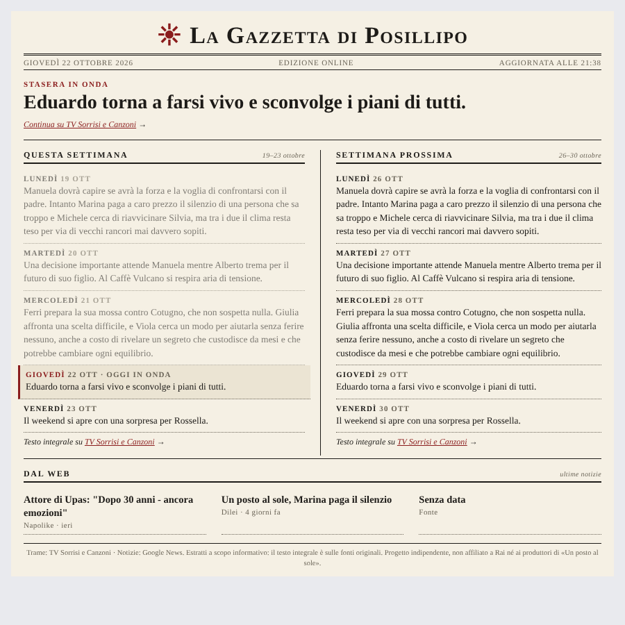

<p align="center"></p>

# Un Posto al Sole per Home Assistant

[](https://hacs.xyz)
[](https://github.com/stefanodr/ha-upas/releases)
[](https://github.com/stefanodr/ha-upas/actions/workflows/validate.yaml)
[](LICENSE)

[](https://my.home-assistant.io/redirect/hacs_repository/?owner=stefanodr&repository=ha-upas&category=integration)

Anticipazioni **giorno per giorno della settimana corrente e della successiva**, più le **ultime notizie dal web**, presentate in una card in **stile quotidiano**.



> Progetto indipendente della community, non affiliato a Rai né ai produttori di «Un posto al sole».

## Cosa fa
- Legge le trame settimanali pubblicate da TV Sorrisi e Canzoni (di norma il sabato per la settimana dopo) e le divide per giorno.
- Raccoglie titoli, testata e data delle notizie da due feed RSS (Google News e Bing News), uniti e senza doppioni. Se una fonte non risponde, usa l'altra.
- Mostra estratti brevi con link alla fonte: il testo integrale resta sul sito originale.
- Nel weekend la "settimana corrente" diventa quella che inizia lunedì, così sai già cosa arriva.
- Se la settimana successiva non è ancora stata pubblicata, la card lo dice ("in arrivo").

## Installazione con HACS
1. HACS → ⋮ → **Repository personalizzati** → incolla `https://github.com/stefanodr/ha-upas`, categoria **Integrazione**.
2. Cerca **Un Posto al Sole**, scarica e **riavvia Home Assistant**.
3. **Impostazioni → Dispositivi e servizi → Aggiungi integrazione → Un Posto al Sole**.

### Installazione manuale
Copia `custom_components/upas` in `<config>/custom_components/upas` e riavvia.

## La card
L'integrazione include la card `custom:upas-card` e prova a registrarla da sola. Su alcune installazioni questo non basta: se vedi l'errore **"Custom element doesn't exist: upas-card"**, aggiungi la risorsa a mano (una volta sola):

1. Attiva la **Modalità avanzata** nel tuo profilo utente.
2. Vai in *Impostazioni → Dashboard → ⋮ → Risorse → Aggiungi risorsa*.
3. URL `/upas_static/upas-card.js`, tipo **Modulo JavaScript**, poi *Crea*.
4. Ricarica il browser con **Ctrl+F5** (nell'app companion: *Impostazioni → Companion app → Debug → Svuota cache frontend*).

Poi, nella dashboard: **Aggiungi scheda → Manuale**:

```yaml
type: custom:upas-card
title: La Gazzetta di Posillipo   # facoltativo
max_news: 6                       # facoltativo
show_news: true                   # facoltativo
```

Per verificare che il file sia servito, apri `http://IP-DI-HA:8123/upas_static/upas-card.js`: devi vedere il codice JavaScript.

## Entità
| Entità | Stato | Attributi principali |
|---|---|---|
| Edizione | data/ora ultimo aggiornamento | `today`, `this_week`, `next_week`, `news` |
| Puntata di oggi | estratto della trama | `date`, `weekday`, `excerpt`, `url` |
| Questa settimana | es. `19–23 ottobre` | `days[]`, `url`, `source`, `published` |
| Prossima settimana | es. `26–30 ottobre` oppure `In arrivo` | come sopra |
| Notizie | numero di notizie | `articles[]` (titolo, testata, url, data) |

Gli ID entità dipendono dalla lingua di Home Assistant (es. `sensor.un_posto_al_sole_puntata_di_oggi` in italiano): controllali in *Impostazioni → Entità*. Un esempio di notifica serale è in [`examples/automation_notifica.yaml`](examples/automation_notifica.yaml).

## Esempio di dashboard
Per una pagina a tutto schermo crea una vista di tipo **Pannello (1 scheda)** e inserisci la card; un esempio è in [`examples/dashboard.yaml`](examples/dashboard.yaml).

## Opzioni
Intervallo di aggiornamento (60–1440 min, default 360), notizie on/off, numero massimo di notizie. Il salvataggio ricarica l'integrazione.

## Fonti e limiti
- Trame: <https://www.sorrisi.com/tag/un-posto-al-sole/> (articoli «le trame dal X al Y»).
- Notizie: Google News e Bing News (RSS).
- Il parsing dipende dalla struttura delle pagine: se una fonte cambia, la card mostra "in arrivo" o nessuna notizia e nei log (livello debug) trovi il dettaglio. I parser stanno in `parsers.py` e sono coperti da test.
- Gli estratti sono limitati a ~280 caratteri per giorno. Rispetta i termini d'uso delle fonti e non abbassare l'intervallo di aggiornamento senza motivo.

## Problemi frequenti
| Sintomo | Cosa fare |
|---|---|
| "Custom element doesn't exist: upas-card" | Aggiungi la risorsa a mano come descritto in [La card](#la-card), poi **Ctrl+F5**. |
| "Prossima settimana: In arrivo" | Normale: le trame vengono pubblicate di norma il sabato precedente. |
| Nessuna notizia | Controlla che l'opzione notizie sia attiva e guarda i log con livello debug (`custom_components.upas`). |
| Trame vuote dopo un cambio di sito | Apri una [issue](https://github.com/stefanodr/ha-upas/issues) indicando l'articolo che non viene letto. |

Per i log dettagliati:
```yaml
logger:
  logs:
    custom_components.upas: debug
```

## Sviluppo
```bash
pip install -r requirements_test.txt
pytest
```

## Licenza
MIT. Icona e logo sono originali (sole sul golfo) e non riproducono il marchio della serie.
